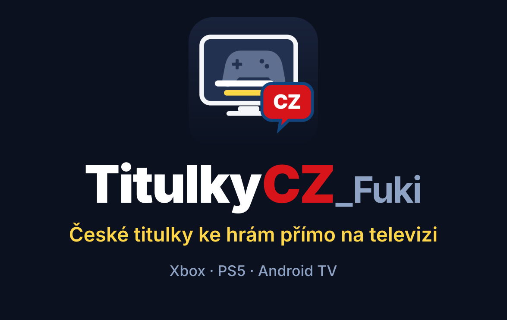

# TitulkyCZ_Fuki

**České titulky ke hrám na Xboxu a PS5 přímo na televizi s Androidem.**

Aplikace čte anglické titulky z obrazu hry, překládá je a ukazuje česky přes obraz z HDMI. Hra běží normálně přes HDMI (plné rozlišení, HDR, zvuk), aplikace se ke konzoli připojuje přes Remote Play jen na pozadí, aby mohla titulky přečíst. Nejrychlejší je režim, kdy titulky čte a překládá telefon a televize je jen zobrazuje.

> TitulkyCZ_Fuki vychází z aplikace **[PlayCaption](https://github.com/AdamRuzick4/PlayCaption-app)**, kterou vytvořil **Adam Růžička** – velké díky! Od verze 0.20.1 ji samostatně vyvíjí Fuki ([@jfnukal](https://github.com/jfnukal)).

## Co umí navíc oproti PlayCaption 0.20.1

- **AI překlad s kontextem hry (Gemini):** pozná hru, sestaví si profil (postavy a jejich rod, jména, termíny) a překládá s ohledem na předchozí věty – „Udělala jsem“ místo „Udělal jsem“.
- **Tabulky hotových překladů:** umí použít komunitní češtinu ke hře (tabulka anglicky → česky) – lidský překlad, okamžitě a bez internetu, i s chybami čtení a u rozdělených replik. Převodník pro RDR2 je v `tools/`.
- **Režim Menu:** přeloží menu, úkoly, deník, inventář řádek po řádku.
- **Pozadí titulků 0–100 %**, jména postav bez dvojtečky, paměť překladů na disku, souběžný překlad, statistiky v záznamu.

Podrobně v [ZMENY.md](ZMENY.md).

## Stažení a instalace

Nejnovější verze: [Releases](https://github.com/jfnukal/TitulkyCZ_Fuki/releases) – soubor `TitulkyCZ_Fuki_*.apk`. Stejný soubor do televize (Android TV / Google TV) i do Android telefonu.

- Funguje jen na televizích s **Androidem** (Android TV / Google TV), ne Samsung (Tizen) ani LG (webOS).
- Ve hře musí být zapnuté **anglické titulky**.
- AI překlad: v telefonu Úpravy → 🤖 AI překlad → klíč z [aistudio.google.com](https://aistudio.google.com) (Get API key). Text titulků se posílá Googlu.
- Tabulky hotových překladů: Úpravy → 📚 Nahrát tabulku (`.tsv` / `.tsv.gz`, řádek = anglicky TAB česky). Komunitní překlady patří jejich autorům – tabulky se nešíří přes tento repozitář.

## Sestavení

Android Studio (Gradle JDK 17 nebo 21) → Build → Generate APKs. Vydání sestavuje GitHub Actions ([.github/workflows/vydani.yml](.github/workflows/vydani.yml)) po nahrání tagu `v*`; podpisový klíč je v Secrets.

## Poděkování a použitý software

- **[PlayCaption](https://github.com/AdamRuzick4/PlayCaption-app)** – © 2026 Adam Růžička, AGPLv3. Základ celé aplikace.
- **[Chiaki](https://git.sr.ht/~thestr4ng3r/chiaki)** (Florian Märkl a přispěvatelé) a **[chiaki-ng](https://github.com/streetpea/chiaki-ng)** – spojení s PS5, AGPLv3.
- Spojení s Xboxem vychází z projektů **xbox-xcloud-player** (MIT) a **XStreaming** (AGPLv3), knihovna **WebRTC**.
- **Google ML Kit** – rozpoznání textu z obrazu, offline překlad. **Google Gemini** – AI překlad (volitelně).

## Licence

**GNU AGPLv3** (viz [LICENSE](LICENSE)), stejně jako PlayCaption a Chiaki. Kdo kód použije a šíří, musí zveřejnit i svůj zdrojový kód pod stejnou licencí.

TitulkyCZ_Fuki je neoficiální projekt a nemá nic společného se společnostmi Microsoft ani Sony Interactive Entertainment. Xbox, PlayStation a PS5 jsou ochranné známky jejich vlastníků.

## Převzaté části (z PlayCaption)

- Zdrojový kód PlayCaption je v tomto repozitáři. Každá vydaná verze má svůj tag (např. `v0.9-beta`) a odpovídající zdrojový kód je u ní v [Releases](https://github.com/AdamRuzick4/PlayCaption-app/releases).
- `app/src/main/jniLibs/*/libchiaki-jni.so`: **nezměněná** nativní knihovna z projektu **Chiaki 2.1.1** (© Florian Märkl a přispěvatelé, licence GNU AGPLv3), převzatá z Android sestavení [Chiaki-TV](https://github.com/505e06b2/Chiaki-TV). Zdrojový kód: [Chiaki](https://git.sr.ht/~thestr4ng3r/chiaki) (verze 2.1.1) a [Chiaki-TV](https://github.com/505e06b2/Chiaki-TV).
- `app/src/main/jniLibs/*/libchiaki-pc.so`: kopie výše uvedené `libchiaki-jni.so` s **jedinou změnou** – závislost `libmediandk.so` je přejmenovaná na `libpcobraz1.so` (stejně dlouhý název v tabulce dynamických řetězců). Používá se jen na telefonu.
- `app/src/main/jniLibs/*/libpcobraz1.so`: vlastní mezivrstva PlayCaption (AGPLv3) mezi Chiaki a systémovým dekodérem, předává obraz z PS5 přímo do paměti. Zdrojový kód: [`native/pcobraz.c`](native/pcobraz.c).
- `app/src/main/java/com/metallic/chiaki/lib/Chiaki.kt`: převzato z Chiaki 2.1.1 (AGPLv3), upraveno (odstraněno Parcelable) – popis úprav je v hlavičce souboru.

### Licence původního projektu

PlayCaption je šířen pod licencí **GNU AGPLv3** (viz soubor [LICENSE](LICENSE)), stejně jako Chiaki. Kdo kód použije a šíří, musí zveřejnit i svůj zdrojový kód pod stejnou licencí.

PlayCaption je neoficiální projekt a nemá nic společného se společností Sony Interactive Entertainment. PlayStation a PS5 jsou ochranné známky jejich vlastníků.
